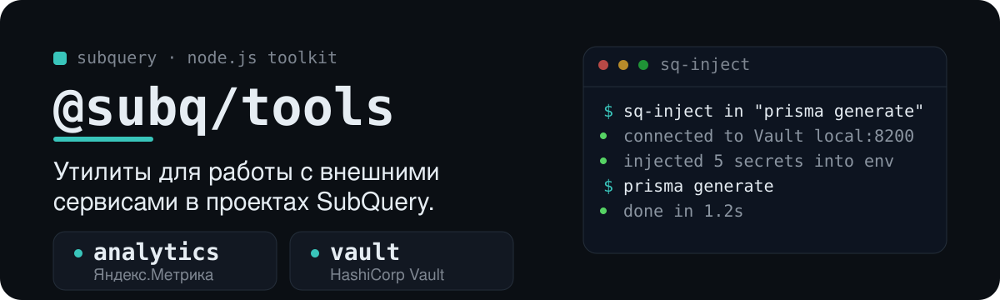

<p align="center">
  
</p>

`@subq/tools` — набор утилит для проектов SubQuery: `analytics` отправляет события в Яндекс.Метрику, а `vault` читает секреты из HashiCorp Vault и умеет подставлять их в окружение команды.


| Модуль                                      | Назначение                                                     |
| ------------------------------------------- | -------------------------------------------------------------- |
| [📊 `analytics`](./src/analytics/README.md) | Отправка аналитических событий в Яндекс.Метрику                |
| [🔐 `vault`](./src/vault/README.md)         | Чтение секретов из HashiCorp Vault и CLI `sq-inject` для инжекта в окружение |


```bash
pnpm add @subq/tools
# или
npm install @subq/tools
```


CLI `sq-inject` запускает команду, заранее подставив в её окружение секреты из Vault:

```bash
npx sq-inject in "prisma generate"
```

Дочерние процессы наследуют эти переменные, поэтому цепочки через `&&`, `||` и пайпы тоже получают секреты. Подробнее о конфигурации — в [README модуля `vault`](./src/vault/README.md).


```bash
pnpm install
pnpm test
pnpm build
pnpm typecheck
```

## Лицензия

MIT